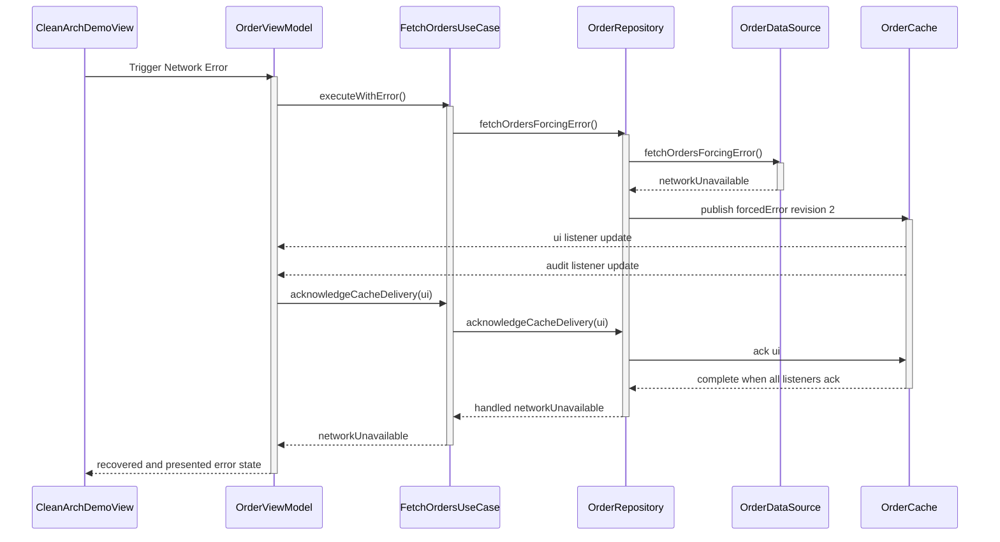

# Log Order Visualization Ideas

## Context

Logical log depth now comes from active call-site nesting instead of label or layer-string matching. That makes the ordering model stable enough to render as structured views instead of relying only on prefix glyphs in a flat console stream.

The examples below use the Clean Architecture network error flow because it exercises UI actions, async functions, handled errors, cache publish events, listener callbacks, and acknowledgements under one origin badge.

## Option 1: Sequence Diagram

A sequence diagram is the clearest visual representation for teaching logical order. Each participant maps to the file or architectural owner that emitted the log, while arrows preserve the nested call order.



Why it helps:

- Shows causality across files without relying on indentation width.
- Makes async callbacks visible as returns or side-channel messages.
- Lets errors, recoveries, and handled errors use different arrow styles or colors.
- Can be generated from logs grouped by origin badge.

Risk:

- Long fan-out flows can become wide. The renderer should collapse low-value detail by default, such as repetitive cache acknowledgements.

## Option 2: Origin Timeline

Render each origin badge as a vertical timeline. Depth is shown by horizontal offset, while each row keeps the original timestamp, actor, elapsed time, and result.

Example shape:

```text
Trigger Network Error   origin: tap-FF7
0ms       UI       CleanArchDemoView.button
0ms       main       OrderViewModel.triggerNetworkError()
1ms       main         FetchOrdersUseCase.executeWithError()
3ms       main           OrderRepository.fetchOrdersForcingError()
4ms       main             OrderDataSource.fetchOrdersForcingError()
314ms     main             OrderDataSource failed: networkUnavailable
337ms     bg             OrderCache publish revision 2
338ms     main              UI listener applied revision 2
361ms     main         Use case failed: networkUnavailable
362ms     main       View model recovered and updated UI
```

Why it helps:

- Preserves the console mental model while making depth easier to scan.
- Works well in Xcode console copy/paste, terminal output, and docs.
- Handles long flows better than a sequence diagram.

Risk:

- Less expressive for cross-participant relationships than a true sequence diagram.

## Option 3: Swimlane Timeline

Group log entries into lanes such as UI, ViewModel, UseCase, Repository, DataSource, Cache, and Background. Within each lane, draw events by time and connect causality with thin linking lines.

Why it helps:

- Makes actor hops and background work easy to see.
- Good fit for the example app because the Clean Architecture demo already teaches layers.
- Highlights when background cache delivery interleaves with main-actor error handling.

Risk:

- Requires more layout logic than sequence diagrams or indented timelines.
- Needs a fallback for projects that do not use conventional layer names.

## Option 4: Collapsible Origin Groups

Keep the existing flat log style, but group entries by origin badge in a viewer. Each group starts with the UI action or task source, then exposes nested calls as an expandable tree.

Suggested levels:

- Summary: origin badge, source, final status, duration, error count.
- Expanded: function entries and exits by logical depth.
- Detail: arguments, file locations, validation notes, recovery notes, and cache listener state.

Why it helps:

- Works directly with logical depth.
- Avoids overwhelming the normal console.
- Provides a path to copy a single interaction as text, JSON, or Mermaid.

Risk:

- Requires a viewer or generated artifact. It is less useful in a raw console.

## Option 5: Flame Chart For Logs

Render function spans as a horizontal flame chart where width is elapsed time and vertical nesting is logical depth. Event-only logs, such as cache publish and acknowledgements, become markers on the nearest active span.

Why it helps:

- Great for performance review.
- Makes slow async children obvious.
- Can show handled errors as colored span endings without losing duration context.

Risk:

- Better for profiling than teaching. It may hide important short-lived control-flow events.

## Recommendation

Start with two generated views from the same parsed log model:

1. Sequence diagram for a selected origin badge.
2. Origin timeline for terminal-friendly review.

The sequence diagram is the strongest teaching artifact. The timeline is the most practical debugging artifact. Both can be produced from the current logical-depth metadata without asking users to maintain architecture-specific matching strings.
